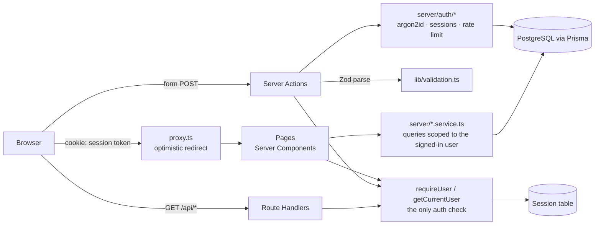

# TaxDesk

A small, production-shaped base project for a tax-preparation web app: registration, sign-in and sign-out, a protected dashboard, and PostgreSQL access through Prisma. All data is dummy data.

It is deliberately small, with no domain features yet. The point is the foundation the next feature lands on: authentication done properly, one strict path to the database, validation on the server, errors that never leak, and tests at every layer.

**Live demo:** https://taxdesk-ten.vercel.app · health check: [/api/health](https://taxdesk-ten.vercel.app/api/health)
**Demo logins:** `demo@taxdesk.dev` / `DemoPass2026` (preparer) · `admin@taxdesk.dev` / `AdminPass2026` (admin)

**Latest test run:** [TEST_RESULTS.md](TEST_RESULTS.md) — 47/47 passing

---

## Stack

| Layer | Choice |
|---|---|
| Framework | Next.js 16 (App Router, Server Components, Server Actions, Cache Components) |
| Language | TypeScript, `strict` |
| UI | React 19, Tailwind CSS v4 |
| Database | PostgreSQL (Neon in production), Prisma 7 with the `pg` driver adapter |
| Validation | Zod 4, one schema shared by forms and server |
| Auth | Session-based, built in-house: argon2id + hashed session tokens in Postgres |
| Tests | Vitest (unit + integration on a real database), Playwright (end-to-end) |
| Hosting | Vercel (deploys on every push to `main`) |

## Architecture



A request moves through these layers in order:

1. **`src/proxy.ts`** sends visitors with no session cookie to `/login?next=…` before anything renders. This is for user experience only. It can't tell a valid cookie from a forged one.
2. **`src/server/auth/guard.ts`** is the real check. Every protected page, Server Action and Route Handler calls `requireUser()` or `getCurrentUser()`. The token is hashed and looked up in `Session`, and an expired session is deleted. The result is cached per request with React `cache()`.
3. **`src/lib/validation.ts`** holds the Zod schemas. The server parses every input; the HTML attributes only mirror the rules for convenience.
4. **`src/server/*.service.ts`** holds the business logic. It is plain TypeScript with no Next.js imports, which makes it testable. A service takes the signed-in user's id from the guard, never from the request.
5. **`src/app/actions/*`** is a thin layer: parse → call service → map expected errors to a `FormState` → redirect.

```
src/
├─ app/
│  ├─ (public)/login, register     sign-in / sign-up
│  ├─ (app)/dashboard              protected: account, session, live DB check
│  ├─ actions/auth.ts              Server Actions: login, register, logout
│  ├─ api/health                   DB reachability check (public)
│  └─ api/me                       signed-in user as JSON, 401 otherwise
├─ server/                         server-only: db, auth, services, errors
├─ lib/                            shared: validation, result types, safe redirect
├─ components/                     form fields, submit button, alerts
└─ proxy.ts
prisma/                            schema, migrations, idempotent seed
tests/unit · tests/integration · tests/e2e
```

## Design decisions

**Database sessions instead of JWTs.** The cookie holds 256 random bits. The database stores only the SHA-256 hash, so a database leak can't be replayed as cookies. Signing out deletes the row, so a copied cookie stops working right away. An end-to-end test replays a signed-out cookie and expects a 401. A stateless JWT can't be revoked that way without adding a denylist, which is a session table again. Sessions last 7 days and slide forward only after half that time, so there's roughly one write every 3.5 days, not one per request.

**Passwords.** Passwords are hashed with argon2id using OWASP parameters. An unknown email is still verified against a dummy hash, so "no such user" and "wrong password" take the same time and return the same message. That stops account enumeration.

**Brute-force protection.** After 5 failed sign-ins, the email is locked for 15 minutes. Failed attempts are stored in Postgres, not in memory, because serverless instances don't share memory.

**Data is scoped to the signed-in user.** Services take the user id from `requireUser()`, never from a form field or URL. The Zod schemas drop unknown fields, so a posted `role` or `userId` is ignored (unit-tested). The dashboard and `/api/me` return only safe fields; the password hash never leaves `server/auth`.

**Errors.** Expected failures (`AppError`: not found, conflict, rate-limited, wrong credentials) become a friendly message, attached to the right field when there is one. Unexpected errors are logged on the server and show a generic message plus a reference. Stack traces and database errors never reach the browser. A failed form keeps what the user typed, except passwords.

**Forms work without JavaScript.** They are Server Actions with progressive enhancement. With JavaScript on, the submit button is disabled while a request is in flight, so a double click can't submit twice.

**Headers and cookies.** Security headers (`X-Frame-Options`, `nosniff`, `Referrer-Policy`, `Permissions-Policy`) are set in `next.config.ts`. The cookie is `httpOnly`, `SameSite=Lax`, and `Secure` in production.

**Cache Components.** This is Next 16's default model. Session reads stream in behind `<Suspense>`, while the static shell (header, page titles) prerenders. The session check calls `connection()`, so time-dependent expiry checks never run during a prerender.

## Tests

Every test name and its result from the latest full run is in **[TEST_RESULTS.md](TEST_RESULTS.md)**. Regenerate it with `npm run test:report`, which runs all three suites and writes the file from their JUnit output.

| Suite | What it proves | Command |
|---|---|---|
| Unit (21) | Zod rules, argon2 hashing, token format, open-redirect guard | `npm test` |
| Integration (15) | Against a real Postgres: registration, login, lockout, session expiry/sliding/revocation, account overview scoped to one user | `npm run test:integration` |
| End-to-end (11) | Real browser against a production build: redirect-and-return, open-redirect guard, validation messages, cookie flags, logout revocation, dashboard + live DB check, per-user data, `/api/me`, health, 404 | `npm run test:e2e` |

Before every push, `npm run lint`, `npm run typecheck` and `npm run test:report` are run locally. There is no hosted CI for now.

The same end-to-end suite runs against the live demo without resetting its data. The register test is skipped there so it doesn't leave accounts behind:

```bash
E2E_BASE_URL=https://taxdesk-ten.vercel.app npx playwright test
```

Last run against the live demo (2026-11-11): **10 passed, 1 skipped (register)**.

## Local setup

Requires Node 22+ and a PostgreSQL database (local, Docker, or a free Neon project).

```bash
git clone <repo-url> taxdesk && cd taxdesk
npm install
cp .env.example .env          # then set DATABASE_URL, DIRECT_URL, TEST_DATABASE_URL
npx prisma migrate deploy && npm run db:seed
npm run dev                   # http://localhost:3000
```

## Deploying (Vercel + Neon)

- Set `DATABASE_URL` (the pooled `-pooler` host) and `DIRECT_URL` (the direct host) in the Vercel project.
- The `vercel-build` script runs `prisma migrate deploy && prisma db seed && next build`. Migrations apply on every deploy, and a failed migration fails the build. The seed is idempotent.
- After deploying, check `GET /api/health`. It returns `{ status: "ok", database: "up", latencyMs }`.

## Adding a feature

Each new feature follows the same path:

1. Model in `prisma/schema.prisma`, then `npm run db:migrate -- --name <change>`
2. Zod schema in `src/lib/validation.ts`, plus unit tests
3. Service functions in `src/server/`, scoped by the signed-in user's id, plus integration tests, including one proving user A can't see user B's rows
4. Server Action: `requireUser()` → parse → service → `toFormError`
5. Page: a static shell plus a `<Suspense>` content component that calls `requireUser()`
6. An end-to-end test of the user-visible flow
